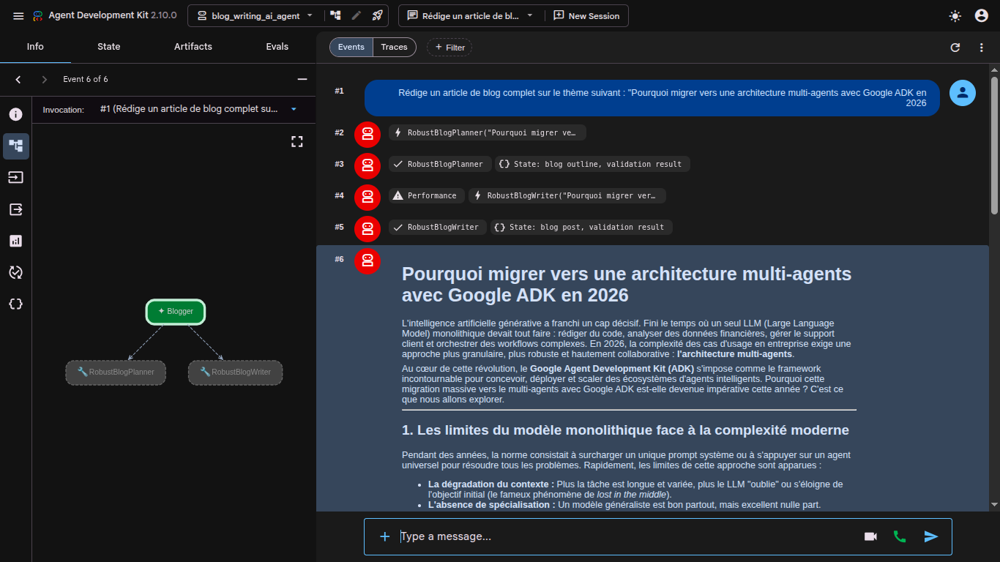

# Blog Writing AI Agent

Agent multi-agents qui rédige un article de blog technique à partir d’un sujet. Il s’appuie sur [Google Agent Development Kit (ADK)](https://google.github.io/adk-docs/) et un modèle Gemini.

Tu donnes un thème. L’agent produit un plan, le fait valider, rédige l’article, le fait valider, puis ajoute des titres alternatifs et des accroches courtes.



## Architecture

`Blogger` est l’agent racine. Il n’écrit pas l’article lui-même : il appelle deux outils, chacun encapsulant une boucle plan / validation ou rédaction / validation.

```text
Blogger
├── RobustBlogPlanner          (jusqu’à 3 essais)
│   ├── BlopPlanner            → state["blog_outline"]
│   └── OutlineValidationChecker → "ok" ou "retry"
└── RobustBlogWriter           (jusqu’à 3 essais)
    ├── BlogWriter             → state["blog_post"]
    └── BlogPostValidationChecker → "ok" ou "retry"
```

Le plan et l’article passent par le state ADK (`blog_outline`, `blog_post`, `validation_result`). Si un validateur répond `retry`, la boucle relance l’agent précédent, dans la limite de 3 itérations.

## Prérequis

- Python 3.12
- Une clé API Gemini : [Google AI Studio](https://aistudio.google.com/apikey)

## Installation

```bash
python3 -m venv env
source env/bin/activate
pip install google-adk python-dotenv
cp .env.example .env
```

Ouvre `.env` et remplace la clé :

```bash
GOOGLE_API_KEY=ta_cle
MODEL=gemini-3.5-flash-lite
```

`MODEL` est lu par tous les agents. `gemini-3.5-flash-lite` est un bon choix par défaut : les modèles plus récents (`gemini-3.8-flash`, `gemini-flash-latest`) renvoient souvent `503 UNAVAILABLE` quand la demande est forte. Un modèle retiré pour les nouveaux comptes renvoie `404 NOT_FOUND`.

## Lancer l’interface

Depuis la racine du projet, avec le venv activé :

```bash
adk web .
```

Ouvre l’URL affichée dans le terminal (en local, en général `http://127.0.0.1:8000`). Choisis l’app `blog_writing_ai_agent`, puis envoie un sujet, par exemple :

```text
Rédige un article de blog complet sur le thème suivant : "Pourquoi migrer vers une architecture multi-agents avec Google ADK en 2026"
```

Dans le graphe d’événements tu dois voir `RobustBlogPlanner`, puis `RobustBlogWriter`, puis l’article en Markdown, trois titres alternatifs et deux accroches.

Relance `adk web` après chaque modification de `.env` ou de `agent.py`.

Cette interface est faite pour le développement local. Elle n’authentifie pas les requêtes : ne l’expose pas sur un réseau public.

## Fichiers

| Fichier | Rôle |
| --- | --- |
| `agent.py` | Définition des agents, des boucles et de `root_agent` |
| `.env` | Clé API et modèle (non versionné) |
| `.env.example` | Modèle de configuration, sans secret |
| `assets/` | Capture de l’interface ADK |
